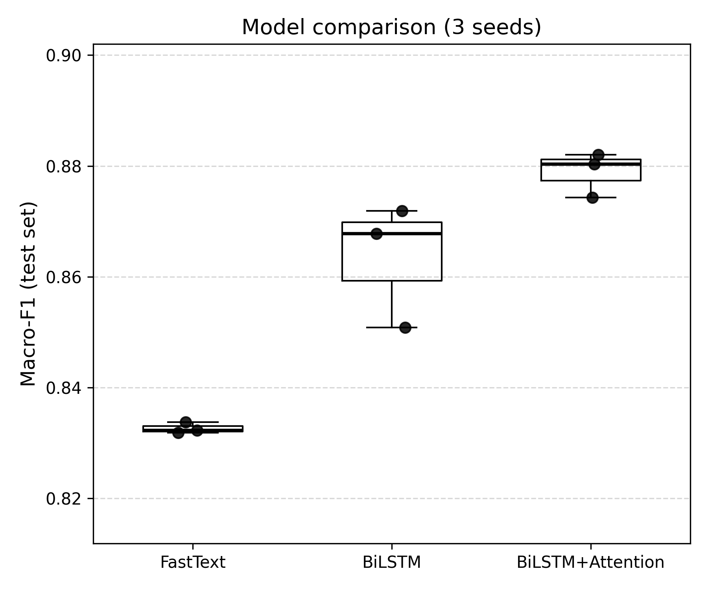
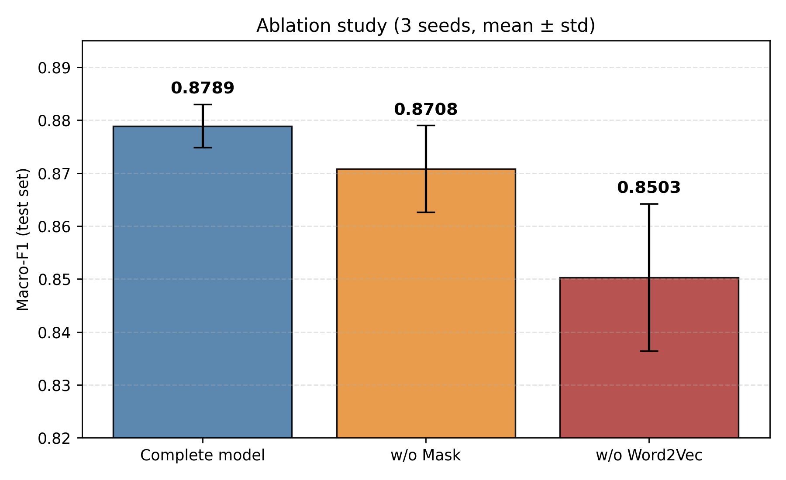
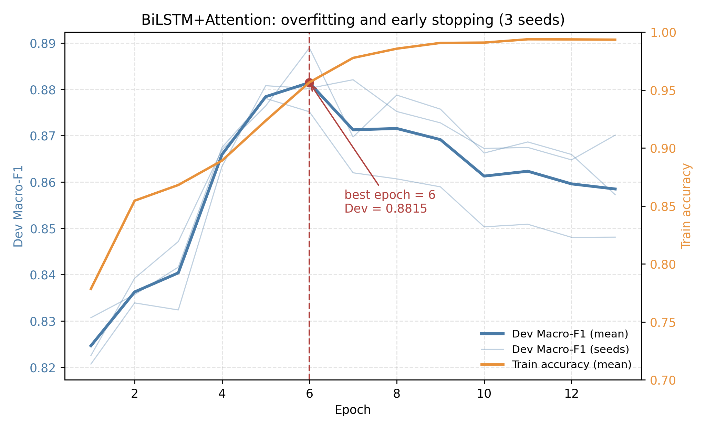
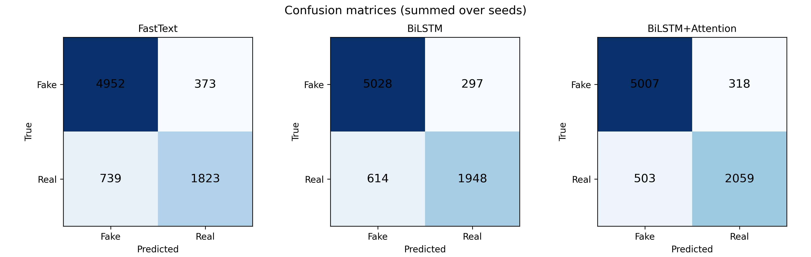

# 基于深度学习的中文社交媒体虚假新闻检测与应用

面向中文社交媒体文本的虚假新闻二分类研究，核心是**轻量级 + 可解释**：
BiLSTM 编码上下文，自注意力汇聚句向量（带 Padding Mask 屏蔽补零位置），
注意力权重直接用于解释"模型为什么这样判"，并落地为三档预警的人机协同筛查系统。

- **数据**：MCFEND 中文平台合并版，清洗后 17,524 条，7 : 1.5 : 1.5 分层划分
- **模型**：2 个基线（FastText / BiLSTM）+ 核心（**BiLSTM+Attention**）
- **实验**：核心模型 3（正则）× 2（类权重）× 2（掩码）× 2（词向量）**全因子 24 配置**，每个 3 个种子；另加 2 个基线（各 3 种子）与 2 种划分对照（各 3 种子），共 **28 配置 / 84 次训练**
- **主指标**：Macro-F1（应对 2.08 : 1 的类别不平衡），另报正类 P/R/F1 与 Accuracy
- **应用**：Streamlit 三档预警（高置信谣言拦截 / 高置信事实放行 / 模糊区间人工复核）

---

## 一、数据来源与致谢

本项目使用 **MCFEND** 数据集，由原作者团队构建并公开发布，仅用于学术研究。
请遵守其原始许可条款，**不要二次分发原始数据**（`news.csv` / `social_context.csv` / `user.csv`）。

> Yupeng Li, Haorui He, Jin Bai, Dacheng Wen.
> **MCFEND: A Multi-source Benchmark Dataset for Chinese Fake News Detection.**
> In *Proceedings of the ACM Web Conference 2024 (WWW '24)*.
> DOI: [10.1145/3589334.3645385](https://doi.org/10.1145/3589334.3645385)
> arXiv: [2403.09092](https://arxiv.org/abs/2403.09092)
> 数据集仓库：<https://github.com/TrustworthyComp>

引用格式见根目录 `CITATION.cff`（GitHub 右侧会自动出现 "Cite this repository" 按钮）。

---

## 二、系统适配

同一份代码可在 Windows / Linux / macOS / Kaggle 上直接运行，**不需要改任何路径**。

### 2.1 支持矩阵

| 平台 | 支持状态 | 数据读取位置 | 产物写入位置 | 备注 |
|---|---|---|---|---|
| **Windows 10 / 11** | ✅ 已验证 | `.\data\raw\mcfend\news.csv` | 项目根目录下 `logs/` `results/` `checkpoints/` | 已在 Python 3.9.25 + torch 2.8.0+cpu 上跑通全流程 |
| **Linux**（Ubuntu 20.04+） | ✅ 支持 | `./data/raw/mcfend/news.csv` | 同上 | 文件名大小写敏感，请注意 `models/`、`utils/` 全小写 |
| **macOS**（Intel / Apple Silicon） | ✅ 支持 | 同 Linux | 同上 | M 系列芯片自动使用 MPS/CPU，无需改动 |
| **Kaggle Notebook** | ✅ 已验证流程 | `/kaggle/input/<dataset>/processed` | `/kaggle/working/`（日志、权重、结果） | `/kaggle/input` 只读，会话结束后 working 不保留，记得下载产物 |

### 2.2 适配是怎么做到的

全部集中在 `config.py`，靠三个机制，不写死任何绝对路径：

1. `BASE_DIR = os.path.dirname(os.path.abspath(__file__))` —— 项目根目录随代码位置走，换盘符、换机器都不用改；
2. `os.path.join` 拼接 —— 自动使用当前系统的分隔符（`\` 或 `/`）；
3. `_first_existing([...])` 候选路径探测 —— 依次尝试本地目录、Kaggle 各类挂载点，命中第一个存在的。

```python
# config.py 片段
RAW_CSV = _first_existing([
    os.path.join(BASE_DIR, 'data', 'raw', 'mcfend', 'news.csv'),
    '/kaggle/input/mcfend-original-dataset/mcfend/news.csv',
    '/kaggle/input/mcfend/mcfend/news.csv',
])
```

Kaggle 数据集改名后，只需往候选列表里加一行，其余代码不用动。

### 2.3 各系统的命令写法

**Windows（PowerShell）**

```powershell
cd D:\chinese-fake-news-detection
conda activate nlp
chcp 65001                      # 控制台切 UTF-8，避免中文日志乱码
python utils\preprocess.py
python scripts\run_all.py --group factorial
python scripts\collect_results.py
python scripts\search_threshold.py --all
```

**Linux / macOS（bash）**

```bash
cd ~/chinese-fake-news-detection
python3 -m pip install -r requirements.txt
python3 utils/preprocess.py
python3 scripts/run_all.py --group factorial
python3 scripts/collect_results.py
python3 scripts/search_threshold.py --all
# 切换正则档位：export CFND_REG=B
# 切换划分方式：export CFND_SPLIT=random
```

**Kaggle Notebook**

```python
!git clone https://github.com/Yangjiayi-05/chinese-fake-news-detection.git
%cd chinese-fake-news-detection
!python scripts/run_all.py --group factorial
```

### 2.4 平台差异与已知的坑

| 现象 | 平台 | 原因与处理 |
|---|---|---|
| 控制台中文显示为乱码 | Windows | 终端代码页不是 UTF-8。执行 `chcp 65001`；文件本身是 UTF-8，不影响数据 |
| `ModuleNotFoundError: config` | 全平台 | 在 `utils/` 子目录里直接跑脚本导致。`preprocess.py` 已自动把项目根加入 `sys.path`；其他脚本请在项目根目录执行 |
| `PermissionError` 写 `/kaggle/input` | Kaggle | 该目录只读。产物统一写到 `WORK_DIR`（Kaggle 下为 `/kaggle/working`） |
| 文件名找不到但明明存在 | Linux / macOS | 分区大小写敏感，`Models/` ≠ `models/`。请严格使用仓库中的小写目录名 |
| 多进程 DataLoader 报错 | Windows | 本项目 `num_workers=0`（默认），不受影响；若自行调大，务必把入口放在 `if __name__ == '__main__':` 下 |
| 显存不足 / 无 GPU | 全平台 | 代码自动降级到 CPU：`DEVICE = cuda if available else cpu`，无需改配置 |

---

## 三、项目结构

```
.
├── app.py                  # 系统入口（Streamlit 三档预警）
├── config.py               # 全局配置：路径、长度、超参、阈值、种子（唯一真源）
├── main.py                 # 单次训练，按验证集 Macro-F1 早停与选模型
├── inference.py            # 推理：事实概率 + 注意力关键词
├── models/                 # fasttext / bilstm / bilstm_attention（掩码由 use_mask 开关控制）
├── utils/                  # preprocess 数据管线、split 重复簇分组、helper 训练与评估
├── scripts/
│   ├── run_all.py          # 批量实验：factorial / main / ablation / reg（reg 含 A/B/C 三档）
│   ├── search_threshold.py # 验证集搜索阈值 + 模糊带反推 + bootstrap 置信区间
│   ├── compare_models.py   # 模型间差异的配对 bootstrap 显著性检验
│   ├── plot_results.py     # 出图：三版箱线图、训练曲线、混淆矩阵
│   ├── collect_results.py  # 汇总全部单次结果（分组跑不会互相覆盖）
│   ├── report_paper.py     # 按论文表格输出四张统计表（主表/消融/正则/划分）
│   ├── analyze_factorial.py# 全因子主效应与交互效应
│   ├── analyze_time.py     # 时间漂移证据、三种划分对比（需原始 CSV）
│   └── check_leakage.py    # 训练/测试集内容重叠自检
├── data/
│   ├── raw/                # 原始数据，不入库
│   ├── processed/          # 随机划分（对照，不入库）
│   ├── processed_group/    # 分组划分（主实验，只入库 vocab.pkl）
│   └── processed_time/     # 时间切分（对照，不入库）
├── requirements.txt
├── 论文实验对照.md          # 论文第四章用哪些实验、选取原则
└── CITATION.cff
```

运行产物（`logs/` `results/` `checkpoints/` `figures/`）由代码在需要时自动创建，
不在仓库里预置空目录。

---

## 四、环境与依赖

Python 3.9+。本机已验证组合：Python 3.9.25 · torch 2.8.0+cpu · pandas 2.3.3 ·
numpy 1.24.4 · scikit-learn 1.6.1 · jieba 0.42.1 · streamlit 1.50.0。

```bash
pip install -r requirements.txt
```

Kaggle 或云端部署时，建议把依赖换成 CPU 版 torch，避免拉取 2GB 的 CUDA 包：

```
--extra-index-url https://download.pytorch.org/whl/cpu
torch==2.2.1+cpu
```

---

## 五、快速开始（三步）

**第 1 步 · 预处理**

把原始数据解压后放到 `data/raw/mcfend/news.csv`，然后：

```bash
python utils/preprocess.py
```

预期输出（可直接用于论文的数据集描述）：

```
样本总数：17524
训练集 12266 / 验证集 2629 / 测试集 2629
词表大小：31526
类别权重：{0: 0.7407, 1: 1.5386}
MAX_LEN=256 截断率：0.76%
```

产物：`data/processed_group/{train,dev,test,vocab}.pkl` 与 `meta.json`。`meta.json` 把份数、
词表规模、截断率、类别权重全部存档，写论文时直接引用，不必回头猜参数。

**第 2 步 · 跑实验（84 次）**

核心模型采用 3（正则）× 2（类权重）× 2（掩码）× 2（词向量）全因子设计：

| 批次 | 内容 | 次数 |
|---|---|---|
| 全因子 | 24 配置 × 3 种子 | 72 |
| 基线 | FastText、BiLSTM（基准配置） | 6 |
| 划分对照 | 随机分层、时间切分（仅核心模型） | 6 |
| | **合计** | **84** |

```bash
# 全因子（72 次）
python scripts/run_all.py --group factorial

# 基线：核心配置已存在会自动跳过，实际只跑 6 次
python scripts/run_all.py --group main

# 划分对照（各 3 次）
set CFND_SPLIT=random && python scripts/run_all.py --group main --models bilstm_attention
set CFND_SPLIT=time   && python scripts/run_all.py --group main --models bilstm_attention

# 汇总全部单次结果（分组跑会覆盖 summary.csv，这里重建总表）
python scripts/collect_results.py

# 按论文表格输出统计（主表 / 消融 / 正则 / 划分对照）
python scripts/report_paper.py
```

**同一配置被多个批次引用时不会重复训练**：`main.run()` 会把模型、种子、正则、
类权重、掩码、词向量、超参打包成签名，已有相同签名就直接复用并打印
`[跳过] … 配置完全一致`。

**文件命名**：基准配置用短名（`bilstm_attention_seed42`），因子变体带后缀
（`bilstm_attention_seed42_rA_c0_m1_v1`），划分对照写入 `results_random/`、
`results_time/`，互不覆盖。

**产物**

| 文件 | 内容 |
|---|---|
| `results/all_results.csv` | 逐次明细（每次一行） |
| `results/summary_all.csv` | 按配置聚合的均值 ± 标准差 |
| `results/skipped.csv` | 本次跳过了哪些配置、复用了哪次结果 |
| `results/factorial_effects.csv` | 全因子主效应与交互（`analyze_factorial.py` 产出） |

每个分组跑完会在日志里打印一张统计表（配置 / n / dev / test ± std / binary / acc），
并汇报「本次 X 个配置 × 3 种子 = Y 个槽位：跳过 Z 个，实际训练 W 次」。
`report_paper.py` 则按论文表格的形式输出主表、消融、正则、划分对照四张表。

> 论文正文用到其中哪些配置、按什么原则选取，见 [`论文实验对照.md`](论文实验对照.md)。
> 简言之：仓库记录全部 84 次训练，论文正文使用其中 7 个配置（21 次），
> 正则 A/B 两档与全因子汇总表放附录。

**第 3 步 · 阈值搜索**

```bash
python scripts/search_threshold.py --all
```

在**验证集**上找使 Macro-F1 最大的分界线，在**测试集**上只报一次结果并给 95% 置信区间。
把打印出的均值取整到 0.05 刻度，写回 `config.py` 的 `DECISION_THRESHOLD`，
应用系统与论文即自动保持一致。

---

## 六、Kaggle 上运行

Kaggle 只作为算力，数据处理在本地完成：

1. 本地跑完 `utils/preprocess.py`（**Kaggle 上不要跑**，脚本会直接提示并退出）；
2. 将 `data/processed_group/`（以及对照用的 `processed/`、`processed_time/`）打包上传为
   Kaggle Dataset，命名 `mcfend-processed-data`；
3. Notebook 里 Add Data 挂载该数据集，并克隆本仓库；
4. 跑实验：`python scripts/run_all.py --group factorial`，再跑 `main`（基线）与两组划分对照。

`config.py` 会按「约定名 → 自动扫描」两级策略找挂载路径：

```
/kaggle/input/mcfend-processed-data/processed
/kaggle/input/datasets/<用户名>/mcfend-processed-data/processed
/kaggle/input/*/processed        ← 数据集换了名字也能兜底找到
```

判定依据是目录里存在 `vocab.pkl`，所以**数据集叫什么名字都不影响运行**。

注意：`/kaggle/input` 只读；会话结束后 `/kaggle/working` 不保留，训练完请把
`results/` 与 `checkpoints/` 下载下来。

---

## 七、部署到 Streamlit Community Cloud

1. 仓库需包含两个部署产物（`.gitignore` 已放行，需 `-f` 强制添加）：

   ```bash
   git add -f data/processed_group/vocab.pkl
   git add -f checkpoints/best_bilstm_attention_seed42.pth
   ```

2. Streamlit Cloud 新建应用，主文件填 `app.py`；
3. 若构建超时，把 `requirements.txt` 顶部换成 CPU 版 torch（见第四节）。

权重或词表缺失时，`app.py` 会直接提示缺少的绝对路径，无需翻云端日志。

---

## 八、实验协议与结果

| 项目 | 设置 |
|---|---|
| 数据划分 | 7 : 1.5 : 1.5，分层抽样，random_state=42 |
| 序列长度 | 256（预处理、训练、推理统一） |
| 词表 | 仅用训练集构建，min_freq=2 |
| 类别不平衡 | 标签平滑 0.05；类别加权作为实验因素（`c1` 时启用 0.7407 / 1.5386），最终配置未采用 |
| 早停依据 | 验证集 Macro-F1，最大 100 轮，patience=8 |
| 主指标 | Macro-F1（另报正类 P/R/F1 与 Accuracy） |
| 阈值 | 验证集网格搜索，测试集只报一次 |
| 正则档位 | A（0.5 / 1e-4 / 0.10）、B（0.6 / 2e-4 / 0.15）、C（0.4 / 5e-5 / 0.05），由全因子实验按验证集确定 |

模型对比统一使用 0.5 默认阈值；系统应用使用搜索得到的最优阈值。

**全因子设计**（核心模型，24 个配置）

| 因素 | 水平 |
|---|---|
| 正则强度 | A / B / C |
| 类别权重 | 有 / 无 |
| Padding Mask | 有 / 无 |
| 词向量初始化 | 有 / 无 |

位序为 (类别权重, 掩码, 词向量)，1 = 开启：

| 正则 \ 组合 | 000 | 001 | 010 | 011 | 100 | 101 | 110 | 111 |
|---|---|---|---|---|---|---|---|---|
| A | ✓ | ✓ | ✓ | ✓ | ✓ | ✓ | ✓ | ✓ |
| B | ✓ | ✓ | ✓ | ✓ | ✓ | ✓ | ✓ | ✓ |
| C | ✓ | ✓ | ✓ | ✓ | ✓ | ✓ | ✓ | ✓ |

最终配置为 **C / 011**（正则 C、不加权、开掩码、开词向量），由 24 格实验按验证集选定，
并集中声明在 `config.py` 的 `FINAL_*` 常量里。
消融表的四行取自这 24 格中的 4 个配置：完整模型（C/011）、去掩码（C/001）、
去词向量（C/010）、加回类权重（C/111）。

**划分方式**由环境变量 `CFND_SPLIT` 决定：

| 取值 | 含义 | 产物目录 | 用途 |
|---|---|---|---|
| `group`（默认） | 按重复簇分组，同源转载绑在同一侧 | `data/processed_group/` | 主实验，无泄漏 |
| `random` | 随机分层 7:1.5:1.5 | `data/processed/` | 对照，量化泄漏带来的虚高 |
| `time` | 按发布时间切分 | `data/processed_time/` | 对照，检验分布漂移 |

```bash
python utils/preprocess.py                    # 默认分组划分
set CFND_SPLIT=random && python utils/preprocess.py   # Windows 生成随机划分
export CFND_SPLIT=random && python utils/preprocess.py  # Linux/macOS
```

跑完 `collect_results.py` 后，把 `results/summary_all.csv` 填进下表（**不要手写数字，直接复制**）：

**主表**

| 模型 | Macro-F1 (mean ± std) | 正类 F1 | Accuracy |
|---|---|---|---|
| FastText | 0.8327 ± 0.0010 | 0.7663 | 0.8590 |
| BiLSTM | 0.8635 ± 0.0112 | 0.8100 | 0.8845 |
| **BiLSTM + Attention** | **0.8789 ± 0.0041** | **0.8335** | **0.8959** |

配对 bootstrap（2000 次重采样，同一测试集）：Attention 比 BiLSTM 高 **+0.0154**
（95% CI [+0.0067, +0.0238]，p=0.000），比 FastText 高 **+0.0462**
（[+0.0347, +0.0580]，p=0.000），两者均显著。





> 消融图只画论文正文使用的两组变体。类别加权作为探索性实验（−0.73 点）未列入图中，
> 其数值见上表最后一行。

**过拟合与早停**

核心模型在验证集第 6 轮达到峰值（0.8815），此后训练准确率继续上升到接近 100%，
而验证集回落至约 0.859，呈现典型的过拟合形态。训练采用早停（patience=8）保存
验证集最优权重，并配合 dropout 0.6、权重衰减 2e-4、词级 dropout 0.15 抑制过拟合。
最终测试集 0.8789 与验证集峰值相差 0.3 个百分点，说明过拟合段不参与评测、泛化仍然良好。



**消融表**（对应全因子中最终档的 4 个配置，标签形如 `BiLSTM+Attention C/c0m0v1`）

| 变体 | 配置 | 文件名后缀 | Macro-F1 | 相对核心 |
|---|---|---|---|---|
| 完整模型 | C/011 | （空） | **0.8789 ± 0.0041** | — |
| 去掉 Padding Mask | C/001 | `_rC_c0_m0_v1` | 0.8708 ± 0.0082 | **−0.0081** |
| 去掉词向量初始化 | C/010 | `_rC_c0_m1_v0` | 0.8503 ± 0.0139 | **−0.0286** |
| 加回类别权重（探索项，论文未采用） | C/111 | `_rC_c1_m1_v1` | 0.8716 ± 0.0038 | **−0.0073** |

前两组是论文正文的消融实验；**第三组为探索性实验**——曾按类别不平衡的常规做法尝试加权，
实测 Macro-F1 反降 0.73 点，故最终模型不采用，该结果保留在仓库中供核查。

**正则档位**

| 档位 | dev | test |
|---|---|---|
| A | 0.8833 | 0.8785 ± 0.0048 |
| B | 0.8812 | 0.8704 ± 0.0108 |
| **C（最终）** | 0.8830 | **0.8789 ± 0.0041** |

**数据划分对照**

| 划分 | Macro-F1 | 相对分组 |
|---|---|---|
| **分组（本文）** | **0.8789 ± 0.0041** | — |
| 随机分层 | 0.8848 ± 0.0073 | +0.0059（泄漏虚高） |
| 时间切分 | 0.5565 ± 0.1095 | −0.3224（分布漂移） |



---

## 九、常见问题

**Q：为什么不用 BERT？**
本项目目标是可解释 + 轻量可部署。BiLSTM+Attention 参数量约百万级，CPU 即可推理，
注意力权重天然对应到分词后的词，可直接做关键词级解释；BERT 类模型的解释需额外归因方法，
参数与显存开销高出一个量级。这是工程权衡，不是能力上限。

**Q：为什么不做 SimHash 近似去重？**
去重会把 17,524 条压到约 4,400 条，训练集只剩约 3,100 条，轻量模型会明显欠拟合，
指标反而下降。因此只做基础清洗，并在论文中如实说明这一取舍。

**Q：为什么注意力要加 mask？**
补零位置参与 softmax 会分走一部分注意力权重，句向量被稀释；屏蔽后权重只在真实词上归一化，
特征更纯，关键词高亮也不会落到无意义的补零位置上。

**Q：0.5 阈值和 0.43 阈值到底用哪个？**
模型对比用 0.5（统一、可复现）；应用系统用验证集搜索出的分界线（对应真实业务场景）。
两者在论文中分别标注即可，不要混用。

---

## 十、引用

软件引用格式见 `CITATION.cff`；数据集引用见第一节。
